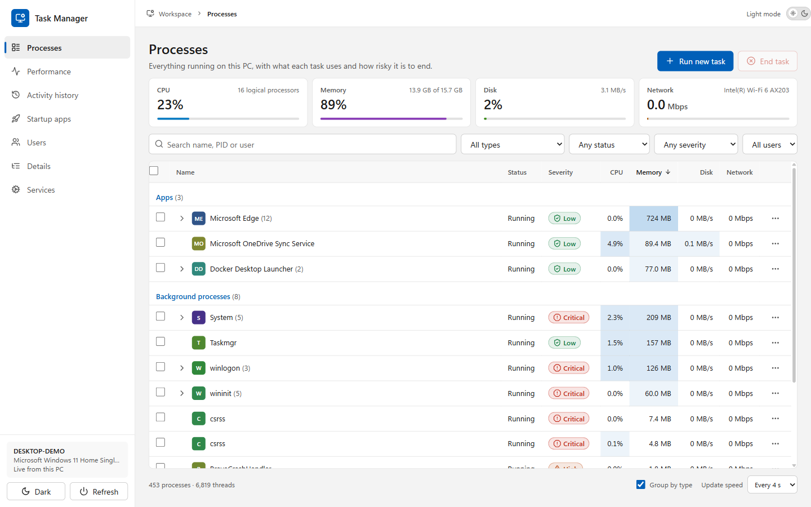
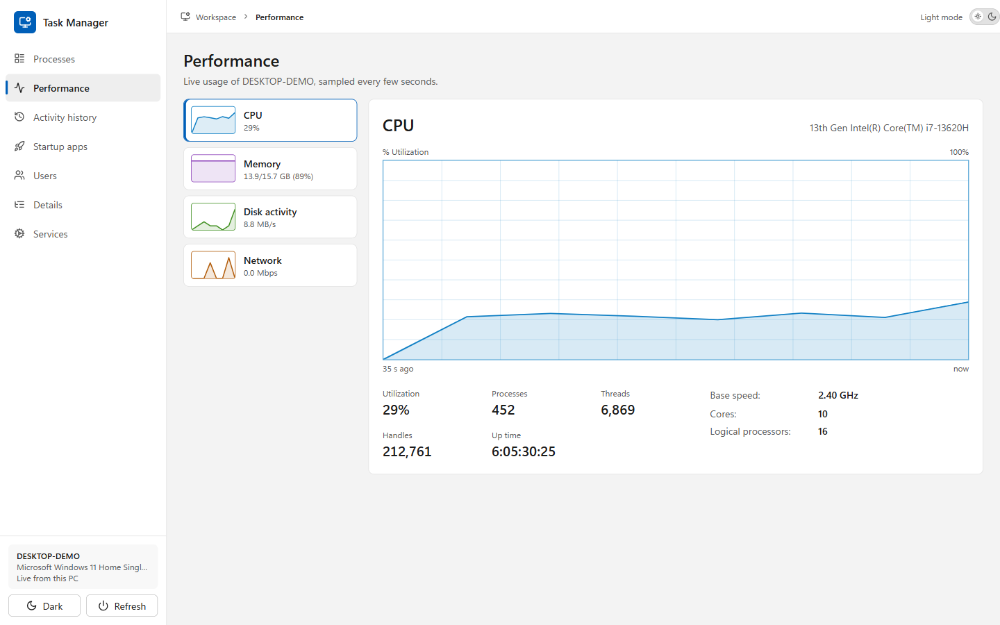
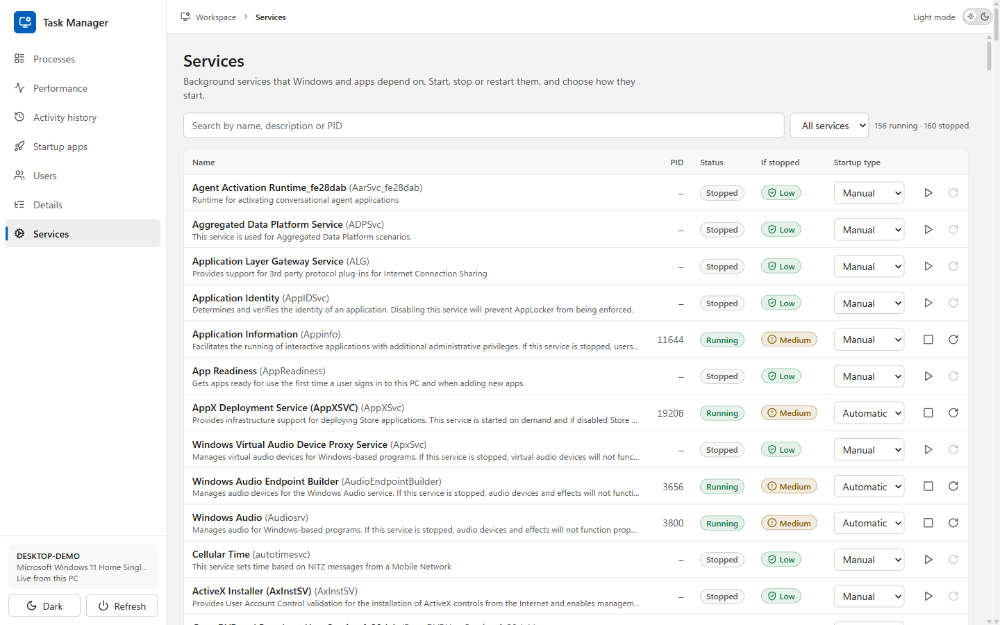

# Task Manager for Windows

[](https://github.com/nithu-only/taskmanager/actions/workflows/ci.yml)
[](https://github.com/nithu-only/taskmanager/releases/latest)
[](LICENSE)

A local web app that shows what is actually happening on **your** PC — which process is
using the memory, which one is pinning the CPU, what starts with Windows, and what the
services are doing. It looks like the Windows Task Manager, but every number comes from the
machine the app is running on.

There is **no database and no demo data**. The app reads Windows directly, and the actions
(suspend, resume, end task, priority, services, startup apps) really happen.

> Run this on the PC you want to inspect. Deployed to a server, it would show the server's
> processes instead of yours.

## Screenshots

Processes — grouped by app, with live CPU, memory, disk and network per process, risk
severity, and real actions:



| Performance | Services |
| --- | --- |
|  |  |

Screenshots were captured on a demo machine; host and user names are masked.

## Requirements

- Windows 10 or 11
- Node.js 20 or newer
- Windows PowerShell 5.1 (installed with Windows — `pwsh` is **not** required)

The portable `TaskManager.exe` below bundles its own Node.js runtime, so end users
need none of these installed.

No `npm install` of native modules is needed, and no environment variables or connection
strings are used.

## Run it

```bash
npm install
npm run dev
```

Then open <http://localhost:3000>.

Other scripts:

| Command | What it does |
| --- | --- |
| `npm run dev` | Development server with hot reload |
| `npm run build` | Production build |
| `npm start` | Serve the production build |
| `npm run typecheck` | TypeScript, no emit |
| `npm run lint` | ESLint |
| `npm run package:exe` | Build a portable, single-file `TaskManager.exe` |

## Portable exe (share with other users)

`npm run package:exe` produces **`packaging/out/TaskManager.exe`** — one ~38 MB file
that runs without Node.js installed. It contains the production build, the PowerShell
helpers, and a private copy of `node.exe`.

What happens when someone double-clicks it:

1. On first run the payload is extracted to `%LOCALAPPDATA%\TaskManagerPortable\app-<version>`.
2. The server starts on a free loopback port (`http://127.0.0.1:<port>`), so it is not
   reachable from the network and Windows Firewall does not prompt.
3. The UI opens in the default browser, and a tray icon keeps the server running.

Tray menu: **Open Task Manager**, **Show server log**, **Exit**. Exiting stops the Node
server and the PowerShell sampler it started.

Double-clicking the exe again just reopens the existing UI. To stop it from a script or
shortcut:

```powershell
TaskManager.exe --stop
```

Notes for distribution:

- The exe is **not code-signed**, so SmartScreen may show "Windows protected your PC".
  Choose *More info → Run anyway*, or sign the exe with your own certificate
  (`signtool sign /fd SHA256 /a TaskManager.exe`).
- Share only `TaskManager.exe`; nothing else needs to travel with it.
- GitHub releases include `SHA256SUMS.txt` and a build attestation — see
  [Verifying a release](#verifying-a-release). Once SignPath Foundation approves the
  project, the exe is signed and shows a verified publisher.
- To remove it, exit via the tray, delete the exe, then delete
  `%LOCALAPPDATA%\TaskManagerPortable`.
- The executable targets Windows 10/11 x64 and must run on the PC you want to inspect.

## How the data gets here

```
Windows
   │  Get-CimInstance Win32_Process, Get-Process, .NET NetworkInterface
   ▼
scripts/sampler.ps1 ── one JSON line per reading (~4 s) ──► src/lib/host.ts (in memory)
                                                              │
                                                    /api/processes, /api/system
                                                              │
                                                        the React UI
```

- `scripts/sampler.ps1` is a single long-lived PowerShell process started by the Node
  server. It prints one JSON line per reading — a 3 second pause plus the ~1 second it takes
  to measure — so the expensive PowerShell startup happens once instead of on every refresh.
- API routes never wait on Windows: they read the newest snapshot from memory and return it.
  A page polling every second costs almost nothing.
- **CPU %** is a delta. The sampler reports each process's total processor time
  (`UserModeTime + KernelModeTime`); the server compares it with the previous sample and
  divides by elapsed time and logical-core count. This is the number that tells you a
  process is *currently* busy — not the average since it started.
- **Disk MB/s** is the same idea using the per-process read/write transfer counters.
- **Memory** is the process working set, and system totals come from
  `Win32_OperatingSystem`.
- **Network** is measured from the adapter byte counters. Windows does not expose reliable
  per-process network usage without a filter driver, so per-process network stays `0` and
  only the system total is shown.
- The activity log is kept in memory (last 300 entries) and disappears when the server stops.

Other helpers, all invoked on demand:

| Script | Used for |
| --- | --- |
| `scripts/proc.ps1` | suspend, resume, kill, priority, spawn |
| `scripts/services.ps1` | list services, start, stop, restart, change startup type |
| `scripts/startup.ps1` | list startup entries, enable/disable/add/remove (current user only) |

`scripts/versioninfo.json` is a cache of publisher/description lookups keyed by executable
path. It is created at runtime and ignored by git.

## Safety model

This app can really end processes, so the risky paths are deliberately narrow:

- **Core Windows processes are never touched.** `csrss`, `winlogon`, `services`, `lsass`,
  `smss`, `System`, and similar are marked *Critical*. The UI disables End task for them and
  the server refuses the request with a 403 before PowerShell is called. Nothing the app
  does can blue-screen Windows.
- Processes Windows needs for a normal session (`explorer`, `dwm`, `svchost`,
  `RuntimeBroker`, …) are marked *High* and require an explicit acknowledgement.
- Ending a task ends its child processes too, the way Task Manager's "End process tree"
  does. Services running inside a killed `svchost` may restart automatically.
- **Suspend** uses `NtSuspendProcess`. A suspended process keeps its memory and loses no
  data; resume it with the same button.
- **Priority** changes apply immediately and only for the current session.
- **Services** usually require administrator rights. When Windows refuses, the app shows the
  error instead of pretending it worked. Critically-required services are blocked before the
  call.
- **Startup apps**: only entries in `HKCU\Software\Microsoft\Windows\CurrentVersion\Run` can
  be changed without elevation. Disabling one moves the value to
  `HKCU\Software\TaskManager\DisabledStartup`, so it is fully reversible and nothing is
  deleted. Entries owned by Windows or an installer (HKLM, Startup folders, scheduled tasks)
  are shown read-only, with the reason in the tooltip.
- The power button in the sidebar does **not** restart your PC. It reads the machine again
  immediately, or clears the activity log.

## Project layout

```
scripts/            PowerShell helpers (sampler + one-shot actions)
src/lib/host.ts     sampler lifecycle, delta maths, in-memory snapshot
src/lib/server.ts   validation, risk model, process/service/startup actions
src/lib/types.ts    shared types, labels, formatters
src/app/api/...     REST endpoints used by the UI
src/app/...         Processes, Performance, Users, Startup, Services, History, Details
src/components/     table, drawers, dialogs, shell
```

## Limitations worth knowing

- Windows only. On any other OS the API returns `501`.
- Sample interval is about 4 seconds, so a very short CPU spike can fall between samples.
- Per-process GPU usage needs vendor tooling (e.g. `nvidia-smi`) and is not shown; the
  Performance page shows CPU, memory, disk and network only.
- Activity history, and the "suspended" badge, reset when the app restarts. Suspended
  processes stay suspended until you resume them or they exit.

## Verifying a release

Every GitHub release contains `TaskManager.exe` and `SHA256SUMS.txt`.

```powershell
# Windows PowerShell
Get-FileHash .\TaskManager.exe -Algorithm SHA256
# compare with the hash in SHA256SUMS.txt

# Build provenance (GitHub artifact attestation)
gh attestation verify .\TaskManager.exe --repo nithu-only/taskmanager
```

Releases built by the `Release` workflow come from the tagged source in this repository.
Once the project is approved by SignPath Foundation, the exe is also Authenticode-signed,
so Windows shows a verified publisher instead of "Unknown publisher".

## Code signing policy

Free code signing provided by [SignPath.io](https://signpath.io/), certificate by
[SignPath Foundation](https://signpath.org/).

- Committers and reviewers: [repository collaborators](https://github.com/nithu-only/taskmanager/settings/access)
- Approvers: [@nithu-only](https://github.com/nithu-only)
- Builds are produced only by the GitHub Actions workflows in `.github/workflows/`.
  Each release is reviewed and manually approved before it is signed.

**Privacy:** This program will not transfer any information to other networked systems
unless specifically requested by the user or the person installing or operating it. The
app reads process, service and startup information locally through Windows APIs and
PowerShell, keeps it in memory on the local machine, and serves the UI only on the
loopback interface (`127.0.0.1`). No telemetry, accounts or external services are used.
See [PRIVACY.md](PRIVACY.md) for details.

## License

[MIT](LICENSE) © 2026 nithu-only
